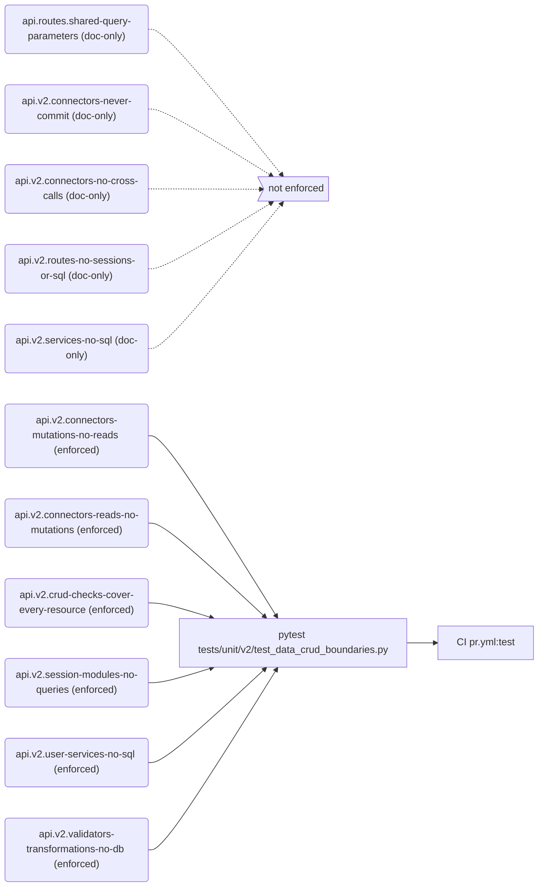
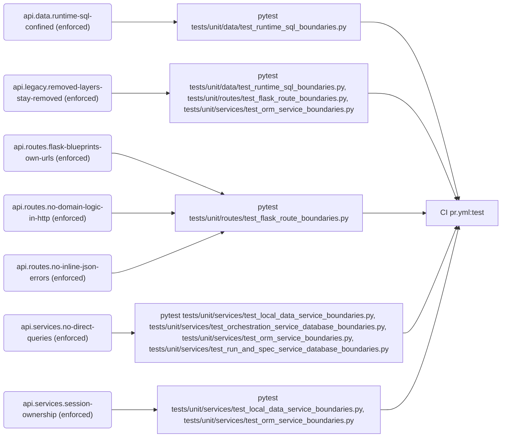
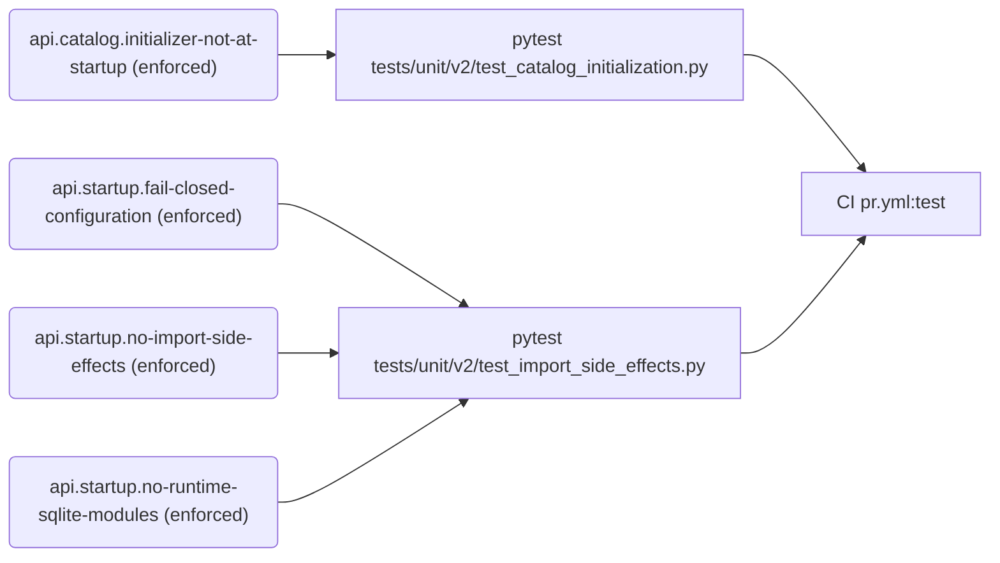
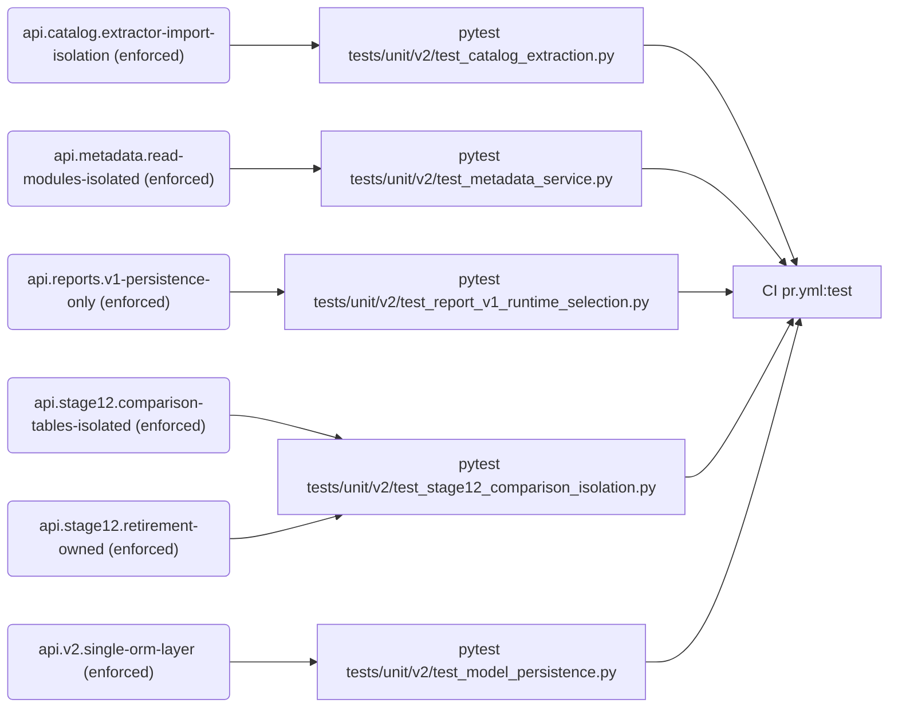
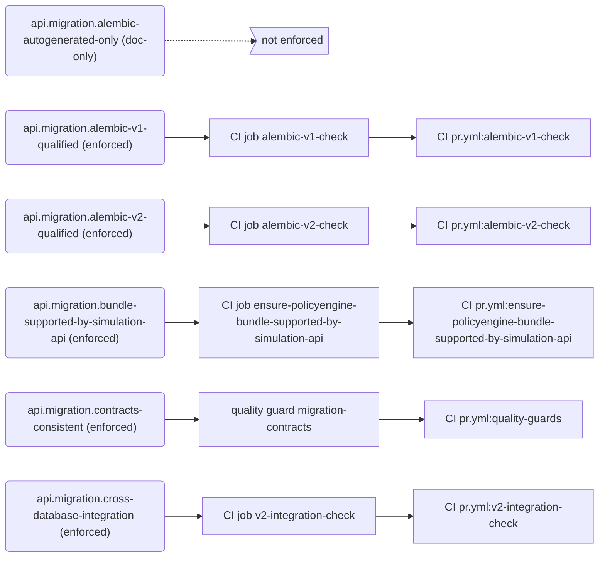
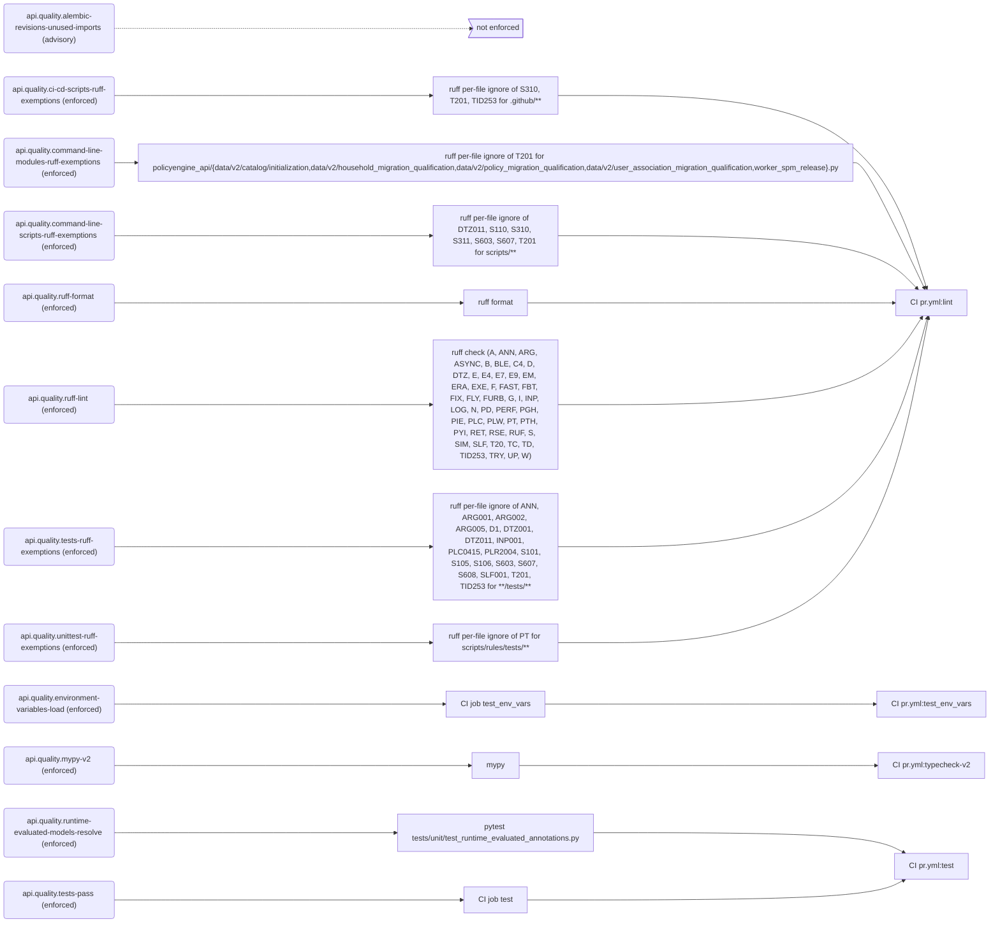
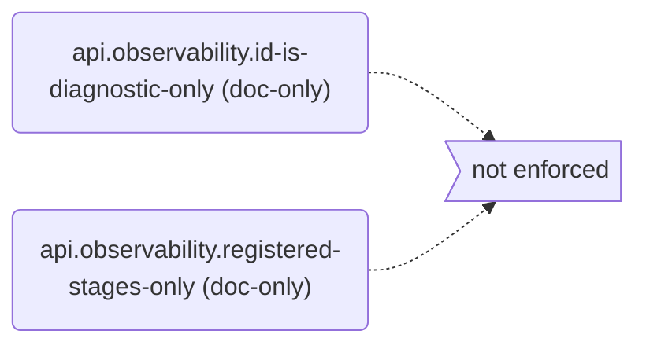
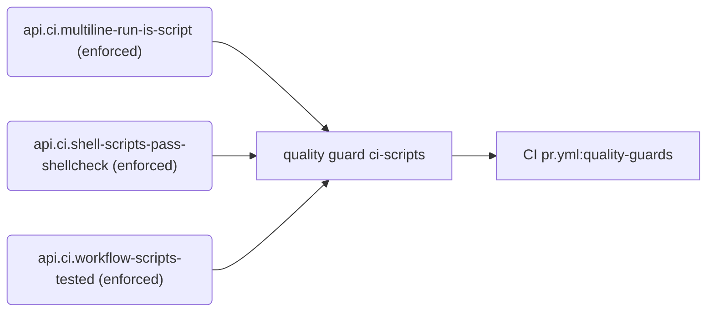
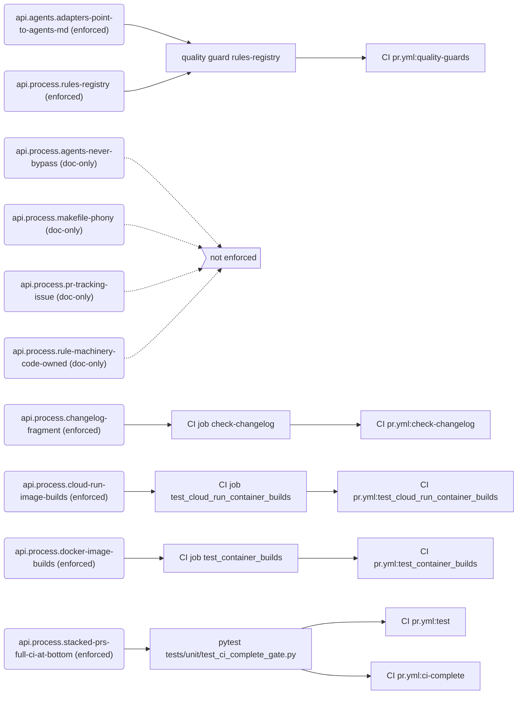

# Rules

Generated by `python -m scripts.rules render` from `rules/registry.toml`. Do not edit by hand.

Every rule that governs `policyengine-api` is listed here with how it is enforced. Blocking rules fail CI. The Gaps section lists what is written down but not yet enforced or proven. To add or change a rule, see `docs/engineering/skills/rules-registry.md`.

## Summary

| Tier | enforced | ratcheted | advisory | doc-only | Total |
| --- | ---: | ---: | ---: | ---: | ---: |
| mechanical | 48 | 0 | 1 | 12 | 61 |
| metric | 0 | 0 | 0 | 0 | 0 |
| judgment | 0 | 0 | 0 | 0 | 0 |

**Blocking:** 48 of 61 rules.

## Gaps

### Not enforced (doc-only)

- `api.migration.alembic-autogenerated-only`: Alembic revisions are autogenerated against an explicitly selected v1 or v2 configuration; never hand-written DDL or data operations.
- `api.observability.id-is-diagnostic-only`: observability_id is used only to query diagnostic records, never for idempotency, cache ownership, authorization, database identity, routing or calculation behavior.
- `api.observability.registered-stages-only`: Span names come from the stage plans in policyengine_api.observability.stages; route and service code never adds span-name string literals.
- `api.process.agents-never-bypass`: Agents never bypass branch rules, even with admin credentials: no gh pr merge --admin and no bypass option; a blocked merge is reported to a human.
- `api.process.makefile-phony`: Command-only Makefile targets are declared in .PHONY, and .PHONY stays in sync when targets are renamed or removed.
- `api.process.pr-tracking-issue`: Every PR has a tracking issue in this repository, and the first line of its description is Fixes #ISSUE_NUMBER.
- `api.process.rule-machinery-code-owned`: Changes to the rule machinery (rules/, scripts/rules/, scripts/guards/, scripts/run_quality_guards.py and CODEOWNERS) need approval from a core developer other than the author.
- `api.routes.shared-query-parameters`: Routes that accept query parameters define them through the shared typed query models, never with a second manual parser.
- `api.v2.connectors-never-commit`: v2 connectors receive a session from the service and never open, commit, roll back or close it.
- `api.v2.connectors-no-cross-calls`: v2 connector modules never call one another to sequence a workflow; the service does the sequencing.
- `api.v2.routes-no-sessions-or-sql`: v2 route modules never open database sessions or construct SQL; they call one service method and map typed failures to HTTP.
- `api.v2.services-no-sql`: v2 services sequence work but never construct SQL expressions, call Session.exec, or define HTTP response models.

### Advisory (checked but not blocking)

- `api.quality.alembic-revisions-unused-imports`: Ruff doesn't lint Alembic revision files (lint.exclude in pyproject.toml), because they must stay exactly as Alembic generates them.

### Unproven (no proof that the checker rejects a bad example)

- `api.catalog.extractor-import-isolation`
- `api.catalog.initializer-not-at-startup`
- `api.data.runtime-sql-confined`
- `api.legacy.removed-layers-stay-removed`
- `api.metadata.read-modules-isolated`
- `api.migration.contracts-consistent`
- `api.process.rules-registry`
- `api.quality.runtime-evaluated-models-resolve`
- `api.reports.v1-persistence-only`
- `api.routes.flask-blueprints-own-urls`
- `api.routes.no-domain-logic-in-http`
- `api.routes.no-inline-json-errors`
- `api.services.no-direct-queries`
- `api.services.session-ownership`
- `api.stage12.comparison-tables-isolated`
- `api.stage12.retirement-owned`
- `api.startup.fail-closed-configuration`
- `api.startup.no-import-side-effects`
- `api.startup.no-runtime-sqlite-modules`
- `api.v2.connectors-mutations-no-reads`
- `api.v2.connectors-reads-no-mutations`
- `api.v2.crud-checks-cover-every-resource`
- `api.v2.session-modules-no-queries`
- `api.v2.single-orm-layer`

### Ratcheted (existing violations still tolerated)

- None.

### Exceptions and review dates

- None.

## API v2 layer boundaries

| Rule | Statement | Tier | Status | Blocking | Enforced by | CI | Proof |
| --- | --- | --- | --- | --- | --- | --- | --- |
| `api.routes.shared-query-parameters` | Routes that accept query parameters define them through the shared typed query models, never with a second manual parser. | mechanical | doc-only | no | nothing | — | — |
| `api.v2.connectors-mutations-no-reads` | v2 mutation connectors (creates, updates, deletes) never issue select or get reads. | mechanical | enforced | yes | pytest `tests/unit/v2/test_data_crud_boundaries.py` | `pr.yml:test` | **unproven** |
| `api.v2.connectors-never-commit` | v2 connectors receive a session from the service and never open, commit, roll back or close it. | mechanical | doc-only | no | nothing | — | — |
| `api.v2.connectors-no-cross-calls` | v2 connector modules never call one another to sequence a workflow; the service does the sequencing. | mechanical | doc-only | no | nothing | — | — |
| `api.v2.connectors-reads-no-mutations` | v2 read connectors never insert, add or delete rows. | mechanical | enforced | yes | pytest `tests/unit/v2/test_data_crud_boundaries.py` | `pr.yml:test` | **unproven** |
| `api.v2.crud-checks-cover-every-resource` | The v2 CRUD boundary checks find modules by filename, so every resource package is covered, and every connector module is named as a create, read, update or delete module. | mechanical | enforced | yes | pytest `tests/unit/v2/test_data_crud_boundaries.py` | `pr.yml:test` | **unproven** |
| `api.v2.routes-no-sessions-or-sql` | v2 route modules never open database sessions or construct SQL; they call one service method and map typed failures to HTTP. | mechanical | doc-only | no | nothing | — | — |
| `api.v2.services-no-sql` | v2 services sequence work but never construct SQL expressions, call Session.exec, or define HTTP response models. | mechanical | doc-only | no | nothing | — | — |
| `api.v2.session-modules-no-queries` | v2 database_session modules own session lifetime only and never build select, insert, update, delete or exec calls. | mechanical | enforced | yes | pytest `tests/unit/v2/test_data_crud_boundaries.py` | `pr.yml:test` | **unproven** |
| `api.v2.user-services-no-sql` | v2 user services (identity, accounts, legacy references and user associations) never build or run SQL themselves or import SQLAlchemy; their connectors do. | mechanical | enforced | yes | pytest `tests/unit/v2/test_data_crud_boundaries.py` | `pr.yml:test` | yes |
| `api.v2.validators-transformations-no-db` | v2 validators and transformations never import SQLAlchemy or SQLModel query or session APIs. | mechanical | enforced | yes | pytest `tests/unit/v2/test_data_crud_boundaries.py` | `pr.yml:test` | yes |

## Runtime persistence and route boundaries

| Rule | Statement | Tier | Status | Blocking | Enforced by | CI | Proof |
| --- | --- | --- | --- | --- | --- | --- | --- |
| `api.data.runtime-sql-confined` | Raw SQL is confined to the data-access layer; runtime modules and report orchestration use sessions and mapped models. | mechanical | enforced | yes | pytest `tests/unit/data/test_runtime_sql_boundaries.py` | `pr.yml:test` | **unproven** |
| `api.legacy.removed-layers-stay-removed` | Removed legacy persistence layers, the temporary DAO module and the legacy endpoints package stay removed. | mechanical | enforced | yes | pytest `tests/unit/data/test_runtime_sql_boundaries.py`, `tests/unit/routes/test_flask_route_boundaries.py`, `tests/unit/services/test_orm_service_boundaries.py` | `pr.yml:test` | **unproven** |
| `api.routes.flask-blueprints-own-urls` | Legacy Flask URLs are owned by blueprints, and the Flask app assembles blueprints without legacy endpoint wiring. | mechanical | enforced | yes | pytest `tests/unit/routes/test_flask_route_boundaries.py` | `pr.yml:test` | **unproven** |
| `api.routes.no-domain-logic-in-http` | Flask routes delegate domain processing (economy comparison, calculation) to services instead of doing it in the HTTP layer. | mechanical | enforced | yes | pytest `tests/unit/routes/test_flask_route_boundaries.py` | `pr.yml:test` | **unproven** |
| `api.routes.no-inline-json-errors` | Flask routes never build JSON error responses inline; they use the shared error handling. | mechanical | enforced | yes | pytest `tests/unit/routes/test_flask_route_boundaries.py` | `pr.yml:test` | **unproven** |
| `api.services.no-direct-queries` | Services never issue database queries or open database connections directly; they delegate persistence to the data-access layer. | mechanical | enforced | yes | pytest `tests/unit/services/test_local_data_service_boundaries.py`, `tests/unit/services/test_orchestration_service_database_boundaries.py`, `tests/unit/services/test_orm_service_boundaries.py`, `tests/unit/services/test_run_and_spec_service_database_boundaries.py` | `pr.yml:test` | **unproven** |
| `api.services.session-ownership` | Migrated services use sessions and mapped models; their public methods never accept persistence objects, and routes and the economy service never manage sessions. | mechanical | enforced | yes | pytest `tests/unit/services/test_local_data_service_boundaries.py`, `tests/unit/services/test_orm_service_boundaries.py` | `pr.yml:test` | **unproven** |

## Import and startup side effects

| Rule | Statement | Tier | Status | Blocking | Enforced by | CI | Proof |
| --- | --- | --- | --- | --- | --- | --- | --- |
| `api.catalog.initializer-not-at-startup` | Application startup modules never import the metadata catalog initializer. | mechanical | enforced | yes | pytest `tests/unit/v2/test_catalog_initialization.py` | `pr.yml:test` | **unproven** |
| `api.startup.fail-closed-configuration` | Default Cloud SQL startup needs no Supabase configuration, and a selected v2 runtime without its database URL fails closed. | mechanical | enforced | yes | pytest `tests/unit/v2/test_import_side_effects.py` | `pr.yml:test` | **unproven** |
| `api.startup.no-import-side-effects` | Importing v2 modules, starting up and serving a request open no network connections and create no files or runtime SQLite databases. | mechanical | enforced | yes | pytest `tests/unit/v2/test_import_side_effects.py` | `pr.yml:test` | **unproven** |
| `api.startup.no-runtime-sqlite-modules` | Runtime SQLite modules are absent from the production package. | mechanical | enforced | yes | pytest `tests/unit/v2/test_import_side_effects.py` | `pr.yml:test` | **unproven** |

## Data source isolation

| Rule | Statement | Tier | Status | Blocking | Enforced by | CI | Proof |
| --- | --- | --- | --- | --- | --- | --- | --- |
| `api.catalog.extractor-import-isolation` | The catalog extractor never imports PolicyEngine core, country packages or v1 metadata directly. | mechanical | enforced | yes | pytest `tests/unit/v2/test_catalog_extraction.py` | `pr.yml:test` | **unproven** |
| `api.metadata.read-modules-isolated` | v2 metadata read modules never import PolicyEngine packages or v1 metadata sources. | mechanical | enforced | yes | pytest `tests/unit/v2/test_metadata_service.py` | `pr.yml:test` | **unproven** |
| `api.reports.v1-persistence-only` | The existing report route and service import only v1 persistence. | mechanical | enforced | yes | pytest `tests/unit/v2/test_report_v1_runtime_selection.py` | `pr.yml:test` | **unproven** |
| `api.stage12.comparison-tables-isolated` | Serving routes and services never read the Stage 12 comparison tables, and production tables never depend on them. | mechanical | enforced | yes | pytest `tests/unit/v2/test_stage12_comparison_isolation.py` | `pr.yml:test` | **unproven** |
| `api.stage12.retirement-owned` | Retiring the Stage 12 comparison schema stays owned by a named follow-up change in the Stage 12 worker contract. | mechanical | enforced | yes | pytest `tests/unit/v2/test_stage12_comparison_isolation.py` | `pr.yml:test` | **unproven** |
| `api.v2.single-orm-layer` | v2 models never create a parallel SQLAlchemy ORM layer alongside SQLModel. | mechanical | enforced | yes | pytest `tests/unit/v2/test_model_persistence.py` | `pr.yml:test` | **unproven** |

## Migration and schema

| Rule | Statement | Tier | Status | Blocking | Enforced by | CI | Proof |
| --- | --- | --- | --- | --- | --- | --- | --- |
| `api.migration.alembic-autogenerated-only` | Alembic revisions are autogenerated against an explicitly selected v1 or v2 configuration; never hand-written DDL or data operations. | mechanical | doc-only | no | nothing | — | — |
| `api.migration.alembic-v1-qualified` | v1 Alembic revisions qualify against a disposable MySQL database. | mechanical | enforced | yes | CI job `alembic-v1-check` | `pr.yml:alembic-v1-check` | — |
| `api.migration.alembic-v2-qualified` | v2 Alembic revisions qualify against a disposable Postgres database, and alembic check finds no schema drift. | mechanical | enforced | yes | CI job `alembic-v2-check` | `pr.yml:alembic-v2-check` | — |
| `api.migration.bundle-supported-by-simulation-api` | A PolicyEngine bundle version change is supported by the simulation API before it merges. | mechanical | enforced | yes | CI job `ensure-policyengine-bundle-supported-by-simulation-api` | `pr.yml:ensure-policyengine-bundle-supported-by-simulation-api` | — |
| `api.migration.contracts-consistent` | Migration route groups and workflow contracts are internally consistent, and their generated docs are current. | mechanical | enforced | yes | quality guard `migration-contracts` | `pr.yml:quality-guards` | **unproven** |
| `api.migration.cross-database-integration` | Cross-database integration tests pass against real MySQL and Postgres. | mechanical | enforced | yes | CI job `v2-integration-check` | `pr.yml:v2-integration-check` | — |

## Code quality and types

| Rule | Statement | Tier | Status | Blocking | Enforced by | CI | Proof |
| --- | --- | --- | --- | --- | --- | --- | --- |
| `api.quality.alembic-revisions-unused-imports` | Ruff doesn't lint Alembic revision files (lint.exclude in pyproject.toml), because they must stay exactly as Alembic generates them. | mechanical | advisory | no | nothing | — | — |
| `api.quality.ci-cd-scripts-ruff-exemptions` | CI/CD scripts under .github may print their results, fetch fixed URLs and import the lazily loaded packages at module level (T201, S310, TID253); every other ruff rule applies to them. | mechanical | enforced | yes | ruff per-file ignore of S310, T201, TID253 for `.github/**` | `pr.yml:lint` | — |
| `api.quality.command-line-modules-ruff-exemptions` | Application modules that also run as command-line programs (if __name__ == "__main__") may print their output (T201); every other ruff rule applies to them. | mechanical | enforced | yes | ruff per-file ignore of T201 for `policyengine_api/{data/v2/catalog/initialization,data/v2/household_migration_qualification,data/v2/policy_migration_qualification,data/v2/user_association_migration_qualification,worker_spm_release}.py` | `pr.yml:lint` | — |
| `api.quality.command-line-scripts-ruff-exemptions` | Command-line scripts under scripts/ may print their output, run other programs, fetch fixed URLs, stamp today's date, pick random samples and ignore a failed best-effort step (T201, S603, S607, S310, DTZ011, S311, S110); every other ruff rule applies to them. | mechanical | enforced | yes | ruff per-file ignore of DTZ011, S110, S310, S311, S603, S607, T201 for `scripts/**` | `pr.yml:lint` | — |
| `api.quality.environment-variables-load` | Required environment variables and credentials load in a deployed-like environment. | mechanical | enforced | yes | CI job `test_env_vars` | `pr.yml:test_env_vars` | — |
| `api.quality.mypy-v2` | Shared query models, FastAPI dependencies, v2 routes and services, and the user sign-in and account-deletion libraries pass mypy with untyped definitions disallowed. | mechanical | enforced | yes | mypy | `pr.yml:typecheck-v2` | — |
| `api.quality.ruff-format` | All Python files are formatted with ruff format. | mechanical | enforced | yes | ruff format | `pr.yml:lint` | — |
| `api.quality.ruff-lint` | All Python code passes ruff check with every rule family selected in pyproject.toml, with no ratchet; families are added one themed group at a time until the selection is ALL. | mechanical | enforced | yes | ruff check (A, ANN, ARG, ASYNC, B, BLE, C4, D, DTZ, E, E4, E7, E9, EM, ERA, EXE, F, FAST, FBT, FIX, FLY, FURB, G, I, INP, LOG, N, PD, PERF, PGH, PIE, PLC, PLW, PT, PTH, PYI, RET, RSE, RUF, S, SIM, SLF, T20, TC, TD, TID253, TRY, UP, W) | `pr.yml:lint` | — |
| `api.quality.runtime-evaluated-models-resolve` | Every package model is one ruff treats as runtime-evaluated (a base resolves, through the import in its own module, to a name in runtime-evaluated-base-classes, or is a same-module class that does), and every Pydantic model and SQLAlchemy mapper resolves its annotations once the package is imported. | mechanical | enforced | yes | pytest `tests/unit/test_runtime_evaluated_annotations.py` | `pr.yml:test` | **unproven** |
| `api.quality.tests-pass` | The unit, contract and to-refactor test suites pass. | mechanical | enforced | yes | CI job `test` | `pr.yml:test` | — |
| `api.quality.tests-ruff-exemptions` | Test files may use pytest's bare assert, need no docstrings, annotations or named constants for magic numbers, and may reach into private members, live outside packages and import inside a test (S101, D1, ANN, PLR2004, SLF001, INP001, PLC0415). They may also use fake credentials, naive datetimes, subprocess calls to repository scripts, SQL built from strings and prints (S105, S106, DTZ001, DTZ011, S603, S607, S608, T201), may import the lazily loaded packages at module level (TID253), and may leave a stand-in's arguments unused (ARG001, ARG002, ARG005). Every other ruff rule applies to tests. | mechanical | enforced | yes | ruff per-file ignore of ANN, ARG001, ARG002, ARG005, D1, DTZ001, DTZ011, INP001, PLC0415, PLR2004, S101, S105, S106, S603, S607, S608, SLF001, T201, TID253 for `**/tests/**` | `pr.yml:lint` | — |
| `api.quality.unittest-ruff-exemptions` | The shared rules tool's tests use unittest, because the tool needs only the standard library, so ruff's pytest-style rules (PT) don't apply to them. | mechanical | enforced | yes | ruff per-file ignore of PT for `scripts/rules/tests/**` | `pr.yml:lint` | — |

## Observability

| Rule | Statement | Tier | Status | Blocking | Enforced by | CI | Proof |
| --- | --- | --- | --- | --- | --- | --- | --- |
| `api.observability.id-is-diagnostic-only` | observability_id is used only to query diagnostic records, never for idempotency, cache ownership, authorization, database identity, routing or calculation behavior. | mechanical | doc-only | no | nothing | — | — |
| `api.observability.registered-stages-only` | Span names come from the stage plans in policyengine_api.observability.stages; route and service code never adds span-name string literals. | mechanical | doc-only | no | nothing | — | — |

## CI workflows and scripts

| Rule | Statement | Tier | Status | Blocking | Enforced by | CI | Proof |
| --- | --- | --- | --- | --- | --- | --- | --- |
| `api.ci.multiline-run-is-script` | A GitHub Actions run: block holds one line of code and no chained commands (&&, \|\|, ;); anything more lives in a tested script under .github/scripts/, called from a single-line step. | mechanical | enforced | yes | quality guard `ci-scripts` | `pr.yml:quality-guards` | yes |
| `api.ci.shell-scripts-pass-shellcheck` | Every shell script under .github/scripts/ passes shellcheck. | mechanical | enforced | yes | quality guard `ci-scripts` | `pr.yml:quality-guards` | yes |
| `api.ci.workflow-scripts-tested` | Every shell script a workflow calls is run by at least one test. | mechanical | enforced | yes | quality guard `ci-scripts` | `pr.yml:quality-guards` | yes |

## Process and repository hygiene

| Rule | Statement | Tier | Status | Blocking | Enforced by | CI | Proof |
| --- | --- | --- | --- | --- | --- | --- | --- |
| `api.agents.adapters-point-to-agents-md` | CLAUDE.md and .github/copilot-instructions.md only point to AGENTS.md; skills and rules are listed in AGENTS.md alone. | mechanical | enforced | yes | quality guard `rules-registry` | `pr.yml:quality-guards` | yes |
| `api.process.agents-never-bypass` | Agents never bypass branch rules, even with admin credentials: no gh pr merge --admin and no bypass option; a blocked merge is reported to a human. | mechanical | doc-only | no | nothing | — | — |
| `api.process.changelog-fragment` | Every PR adds a changelog.d fragment. | mechanical | enforced | yes | CI job `check-changelog` | `pr.yml:check-changelog` | — |
| `api.process.cloud-run-image-builds` | The Cloud Run container image builds. | mechanical | enforced | yes | CI job `test_cloud_run_container_builds` | `pr.yml:test_cloud_run_container_builds` | — |
| `api.process.docker-image-builds` | The API Docker image builds. | mechanical | enforced | yes | CI job `test_container_builds` | `pr.yml:test_container_builds` | — |
| `api.process.makefile-phony` | Command-only Makefile targets are declared in .PHONY, and .PHONY stays in sync when targets are renamed or removed. | mechanical | doc-only | no | nothing | — | — |
| `api.process.pr-tracking-issue` | Every PR has a tracking issue in this repository, and the first line of its description is Fixes #ISSUE_NUMBER. | mechanical | doc-only | no | nothing | — | — |
| `api.process.rule-machinery-code-owned` | Changes to the rule machinery (rules/, scripts/rules/, scripts/guards/, scripts/run_quality_guards.py and CODEOWNERS) need approval from a core developer other than the author. | mechanical | doc-only | no | nothing | — | — |
| `api.process.rules-registry` | Every rule is registered in rules/registry.toml, is enforced where it claims to be, and its rendered views are current. | mechanical | enforced | yes | quality guard `rules-registry` | `pr.yml:quality-guards` | **unproven** |
| `api.process.stacked-prs-full-ci-at-bottom` | In a stack of pull requests, only the lowest unmerged one runs the full PR workflow. Every pr.yml job is needed by the CI complete gate, which fails on the pull requests above it and otherwise passes only when every job passed, so a stack merges bottom-up and nothing merges untested. | mechanical | enforced | yes | pytest `tests/unit/test_ci_complete_gate.py` | `pr.yml:test`, `pr.yml:ci-complete` | yes |

