# Rules

Generated by `python -m scripts.rules render` from `rules/registry.toml`. Do not edit by hand.

Every rule that governs `policyengine-api` is listed here with how it is enforced. Blocking rules fail CI. The Gaps section lists what is written down but not yet enforced or proven. To add or change a rule, see `docs/engineering/skills/rules-registry.md`.

## Summary

| Tier | enforced | ratcheted | advisory | doc-only | Total |
| --- | ---: | ---: | ---: | ---: | ---: |
| mechanical | 71 | 7 | 1 | 8 | 87 |
| metric | 2 | 0 | 0 | 0 | 2 |
| judgment | 0 | 0 | 0 | 1 | 1 |

**Blocking:** 80 of 90 rules.

## Gaps

### Not enforced (doc-only)

- `api.microdata.weights-not-values`: Microdata columns are weights, values, labels or counts: weights are only summed plainly to count entities or passed as weights=, values are aggregated with their own entity's weights, labels only group or filter, and counts derive from weights.
- `api.migration.alembic-autogenerated-only`: Alembic revisions are autogenerated against an explicitly selected v1 or v2 configuration; never hand-written DDL or data operations.
- `api.observability.id-is-diagnostic-only`: observability_id is used only to query diagnostic records, never for idempotency, cache ownership, authorization, database identity, routing or calculation behavior.
- `api.observability.registered-stages-only`: Span names come from the stage plans in policyengine_api.observability.stages; route and service code never adds span-name string literals.
- `api.process.agents-never-bypass`: Agents never bypass branch rules, even with admin credentials: no gh pr merge --admin and no bypass option; a blocked merge is reported to a human.
- `api.process.agents-suppress-as-last-resort`: Agents add an inline suppression (noqa or type: ignore) only when neither a code change nor a checker setting removes the finding, and a PR lists every inline suppression it adds, with the reason. That each suppression names its code and gives its reason is the mechanical rule api.quality.suppressions-explained.
- `api.process.makefile-phony`: Command-only Makefile targets are declared in .PHONY, and .PHONY stays in sync when targets are renamed or removed.
- `api.process.rule-machinery-code-owned`: Changes to the rule machinery (rules/, scripts/rules/, scripts/guards/, scripts/run_quality_guards.py and CODEOWNERS) need approval from a core developer other than the author.
- `api.routes.shared-query-parameters`: Routes that accept query parameters define them through the shared typed query models, never with a second manual parser.

### Advisory (checked but not blocking)

- `api.quality.alembic-revisions-unused-imports`: Ruff neither lints nor formats Alembic revision files (extend-exclude in pyproject.toml), because they must stay exactly as Alembic generates them.

### Unproven (no proof that the checker rejects a bad example)

- `api.catalog.extractor-import-isolation`
- `api.catalog.initializer-not-at-startup`
- `api.data.runtime-sql-confined`
- `api.legacy.removed-layers-stay-removed`
- `api.metadata.read-modules-isolated`
- `api.migration.contracts-consistent`
- `api.process.rules-registry`
- `api.quality.runtime-evaluated-models-resolve`
- `api.reports.v1-persistence-only`
- `api.routes.flask-blueprints-own-urls`
- `api.routes.no-domain-logic-in-http`
- `api.routes.no-inline-json-errors`
- `api.services.no-direct-queries`
- `api.services.session-ownership`
- `api.stage12.comparison-tables-isolated`
- `api.stage12.retirement-owned`
- `api.startup.fail-closed-configuration`
- `api.startup.no-import-side-effects`
- `api.startup.no-runtime-sqlite-modules`
- `api.v2.connectors-mutations-no-reads`
- `api.v2.connectors-reads-no-mutations`
- `api.v2.crud-checks-cover-every-resource`
- `api.v2.session-modules-no-queries`
- `api.v2.single-orm-layer`

### Ratcheted (existing violations still tolerated)

- `api.dependencies.declared-and-used`: 14 remaining in `rules/baselines/deptry.txt`
- `api.quality.suppressions-explained`: 29 remaining in `rules/baselines/suppressions.txt`
- `api.quality.tests-assert`: 21 remaining in `rules/baselines/tests-without-checks.txt`
- `api.v2.connectors-no-cross-calls`: 7 remaining in `rules/baselines/import-linter-api-v2-connectors-independent.txt`
- `api.v2.pure-modules-no-database`: 1 remaining in `rules/baselines/import-linter-api-v2-pure-modules-no-database.txt`
- `api.v2.routes-no-sessions-or-sql`: 4 remaining in `rules/baselines/v2-layers-routes.txt`
- `api.v2.types-transformations-no-validators`: 4 remaining in `rules/baselines/import-linter-api-v2-types-transformations-no-validators.txt`

### Exceptions and review dates

- `api.data.sqlalchemy-and-alembic-only`: exception for `migrations/*/versions/*.py` allowed as a migration-revision (Alembic generates the revisions, and they are where schema changes belong, so the check doesn't scan them. Ruff skips the same files (extend-exclude in pyproject.toml).)
- `api.data.sqlalchemy-and-alembic-only`: exception for `policyengine_api/data/orm_pool_events.py` (`attribute ._sock`) allowed as a driver-access (The v1 pool's diagnostics read the file descriptor and local port of pymysql's socket from the driver connection a SQLAlchemy pool event passes them, because SQLAlchemy has no API for a connection's socket. They never read or write through the socket or the driver connection, and import no driver.)
- `api.data.sqlalchemy-and-alembic-only`: exception for `policyengine_api/data/v2/catalog/publication_staging.py` (`attribute .driver_connection`) allowed as a driver-access (Catalog publication runs COPY through the psycopg connection beneath a SQLAlchemy Connection that SQLAlchemy opened and still manages, so the transaction stays SQLAlchemy's.)
- `api.data.sqlalchemy-and-alembic-only`: exception for `policyengine_api/data/v2/catalog/publication_staging.py` (`call STAGING_METADATA.create_all()`) allowed as a schema-change (The publication staging tables are TEMPORARY with ON COMMIT DROP, so Postgres drops them when the publishing transaction commits and they are not persistent schema; test_publication_staging_tables_are_temporary_and_dropped_at_commit checks every table.)
- `api.data.sqlalchemy-and-alembic-only`: exception for `policyengine_api/data/v2/catalog/publication_staging.py` (`import psycopg.sql`) allowed as a driver-access (Catalog publication streams rows with Postgres COPY ... FROM STDIN, which SQLAlchemy has no API for, and composes the COPY statement with psycopg's SQL composition.)
- `api.data.sqlalchemy-and-alembic-only`: exception for `policyengine_api/data/v2/catalog/publication_staging.py` (`import psycopg.types.json.Jsonb`) allowed as a driver-access (Catalog publication's COPY sends JSON values with psycopg's JSONB adapter.)
- `api.dependencies.declared-and-used`: exception for `gcp/cloud_run/start.sh` (`gunicorn`) allowed as a not-imported-package (The Cloud Run start command runs gunicorn as the server process; no module imports it.)
- `api.dependencies.declared-and-used`: exception for `gcp/cloud_run/start.sh` (`uvicorn`) allowed as a not-imported-package (gunicorn loads uvicorn's worker class by name (--worker-class uvicorn.workers.UvicornWorker); no module imports it.)
- `api.dependencies.declared-and-used`: exception for `policyengine_api/data/orm.py` (`pymysql`) allowed as a not-imported-package (The Cloud SQL connector loads the MySQL driver by name (driver="pymysql"), as SQLAlchemy's mysql+pymysql dialect does; no module imports it.)
- `api.dependencies.install-from-lock`: exception for `.github/scripts/install_locked_ruff.sh` (`pip install "ruff==`) allowed as a pinned-tool (Installs the ruff version uv.lock pins, read from uv.lock, without installing the whole project for the lint job.)
- `api.dependencies.install-from-lock`: exception for `.github/scripts/verify_observability_collector.sh` (`uv run --no-project --with grpcio --with opentelemetry-proto`) until the deploy job syncs the project with uv sync --frozen and the check runs through uv run --frozen (The collector check runs in the deploy job without installing the project; grpcio and opentelemetry-proto are locked only as transitive dependencies of the project.)
- `api.dependencies.install-from-lock`: exception for `.github/workflows/pr.yml` (`pip install "shellcheck-py==`) allowed as a pinned-tool (shellcheck is a command-line tool the ci-scripts guard runs; it is not a dependency of the project.)
- `api.dependencies.install-from-lock`: exception for `.github/workflows/push.yml` (`pip install "shellcheck-py==`) allowed as a pinned-tool (shellcheck is a command-line tool the ci-scripts guard runs; it is not a dependency of the project.)
- `api.dependencies.install-from-lock`: exception for `.github/workflows/update-policyengine-bundle.yaml` (`pip install requests uv`) until the workflow installs uv with astral-sh/setup-uv at a pinned version and runs its Python through uv run --frozen (The bundle updater changes uv.lock, so it runs before a matching lock exists; it installs uv itself and requests for its inline Python with setup-python's interpreter.)
- `api.dependencies.install-from-lock`: exception for `docker/Dockerfile` (`pip install "policyengine[models]==`) until the image installs from uv.lock (uv sync --frozen, or uv export --frozen piped to pip install --no-deps), or is removed (The image packages the PolicyEngine .py bundle for interactive use, not this project; uv.lock locks this project. The bundle updater keeps the pin equal to pyproject.toml's, but ipython and the bundle's own dependencies are not pinned.)
- `api.quality.file-length`: exception for `migrations/*/versions/*.py` allowed as a migration-revision (Alembic revisions stay exactly as Alembic generated them, and an applied revision has already run against a database, so it is never split. Ruff skips the same files (extend-exclude in pyproject.toml).)

## API v2 layer boundaries

| Rule | Statement | Tier | Status | Blocking | Enforced by | CI | Proof |
| --- | --- | --- | --- | --- | --- | --- | --- |
| `api.routes.shared-query-parameters` | Routes that accept query parameters define them through the shared typed query models, never with a second manual parser. | mechanical | doc-only | no | nothing | — | — |
| `api.v2.connectors-mutations-no-reads` | v2 mutation connectors (creates, updates, deletes) never issue select or get reads. | mechanical | enforced | yes | pytest `tests/unit/v2/test_data_crud_boundaries.py` | `pr.yml:test` | **unproven** |
| `api.v2.connectors-never-commit` | v2 connectors receive a session from the service and never open (with a session factory or a database_session container), commit, roll back or close it, or import the v1 ORM, the v2 database or a database_session module. | mechanical | enforced | yes | quality guard `v2-layers` | `pr.yml:quality-guards` | yes |
| `api.v2.connectors-no-cross-calls` | v2 connector modules never import one another, so they cannot call one another to sequence a workflow; the service does the sequencing. | mechanical | ratcheted | yes | import-linter `pyproject.toml` | `pr.yml:quality-guards` | yes |
| `api.v2.connectors-reads-no-mutations` | v2 read connectors never insert, add or delete rows. | mechanical | enforced | yes | pytest `tests/unit/v2/test_data_crud_boundaries.py` | `pr.yml:test` | **unproven** |
| `api.v2.crud-checks-cover-every-resource` | The v2 CRUD boundary checks find modules by filename, so every resource package is covered, and every connector module is named as a create, read, update or delete module. | mechanical | enforced | yes | pytest `tests/unit/v2/test_data_crud_boundaries.py` | `pr.yml:test` | **unproven** |
| `api.v2.files-assigned-to-layers` | Every .py file under services/v2 and fastapi_routes/v2 gets a layer from its file name alone, so the layer rules check it. A file that can't be renamed, outside a database_connectors package, needs a [[rule.exception]] for this rule in rules/registry.toml; it then gets the route checks under fastapi_routes/v2, or the validator, transformation and types checks under services/v2. | mechanical | enforced | yes | quality guard `v2-layers` | `pr.yml:quality-guards` | yes |
| `api.v2.import-layers` | v2 route modules may import v2 services and v2 data modules, and v2 services may import v2 data modules, never the reverse, directly or through other modules. | mechanical | enforced | yes | import-linter `pyproject.toml` | `pr.yml:quality-guards` | yes |
| `api.v2.pure-modules-no-database` | v2 validators, transformations and types never reach SQLAlchemy, SQLModel, a connector, a database_session module or the v2 database module, directly or through other modules, except through the v2 table models; imports under TYPE_CHECKING count. | mechanical | ratcheted | yes | import-linter `pyproject.toml` | `pr.yml:quality-guards` | yes |
| `api.v2.pure-modules-no-session-calls` | v2 validators, transformations, types, process-state modules, package __init__ files and files under services/v2 excepted from api.v2.files-assigned-to-layers import nothing from SQLAlchemy or SQLModel but the Session type, import no connector, database_session, v1 ORM or v2 database module, and call no session method, SQLAlchemy or SQLModel function or session factory; they work on values and rows a connector loaded. | mechanical | enforced | yes | quality guard `v2-layers` | `pr.yml:quality-guards` | yes |
| `api.v2.routes-import-no-database-access` | v2 route modules never import a connector, a database_session module or the v2 database module; they call a service, which does. | mechanical | enforced | yes | import-linter `pyproject.toml` | `pr.yml:quality-guards` | yes |
| `api.v2.routes-no-sessions-or-sql` | v2 route modules never open database sessions or construct SQL: they import no SQLAlchemy, SQLModel, connector, database_session, v1 ORM or v2 database module, and call no SQL builder, session method or session factory; they call one service method and map typed failures to HTTP. | mechanical | ratcheted | yes | quality guard `v2-layers` | `pr.yml:quality-guards` | yes |
| `api.v2.services-no-sql` | v2 services sequence work but never construct SQL expressions (they import nothing from SQLAlchemy or SQLModel but the Session type and sqlalchemy.exc), call Session.exec or another data-access session method, or define HTTP response models (they import no FastAPI or Starlette). | mechanical | enforced | yes | quality guard `v2-layers` | `pr.yml:quality-guards` | yes |
| `api.v2.session-modules-no-data-access` | v2 database_session modules sit directly in their resource package and only open, commit, roll back and close sessions: they call no data-access session method (add, get, merge, exec, execute and so on) or SQL builder, and import no connector. | mechanical | enforced | yes | quality guard `v2-layers` | `pr.yml:quality-guards` | yes |
| `api.v2.session-modules-no-queries` | v2 database_session modules own session lifetime only and never build select, insert, update, delete or exec calls. | mechanical | enforced | yes | pytest `tests/unit/v2/test_data_crud_boundaries.py` | `pr.yml:test` | **unproven** |
| `api.v2.types-transformations-no-validators` | v2 types and transformations modules never import a validators module, directly or through other modules; validators import types, not the reverse. | mechanical | ratcheted | yes | import-linter `pyproject.toml` | `pr.yml:quality-guards` | yes |
| `api.v2.user-services-no-sql` | v2 user services (identity, accounts, legacy references and user associations) never build or run SQL themselves or import SQLAlchemy; their connectors do. | mechanical | enforced | yes | pytest `tests/unit/v2/test_data_crud_boundaries.py` | `pr.yml:test` | yes |
| `api.v2.validators-transformations-no-db` | v2 validators and transformations never import SQLAlchemy or SQLModel query or session APIs. | mechanical | enforced | yes | pytest `tests/unit/v2/test_data_crud_boundaries.py` | `pr.yml:test` | yes |

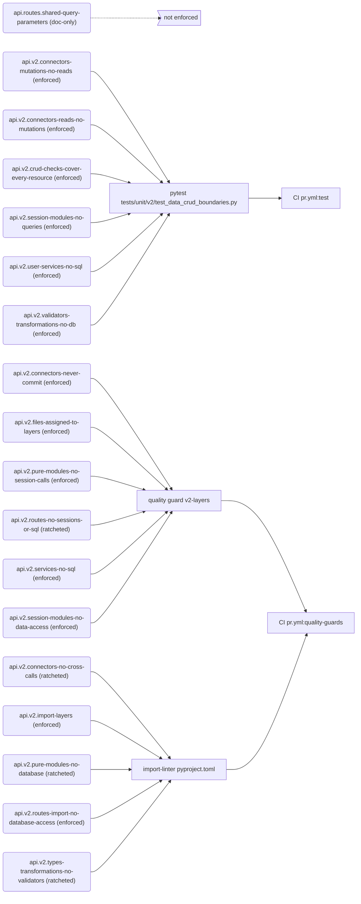

## Runtime persistence and route boundaries

| Rule | Statement | Tier | Status | Blocking | Enforced by | CI | Proof |
| --- | --- | --- | --- | --- | --- | --- | --- |
| `api.data.runtime-sql-confined` | Raw SQL is confined to the data-access layer; runtime modules and report orchestration use sessions and mapped models. | mechanical | enforced | yes | pytest `tests/unit/data/test_runtime_sql_boundaries.py` | `pr.yml:test` | **unproven** |
| `api.data.sqlalchemy-and-alembic-only` | Code connects to relational databases only through SQLAlchemy engines, connections and sessions, never by calling a database driver directly, and changes persistent schema only through Alembic revisions. | mechanical | enforced | yes | pytest `tests/unit/data/test_database_access_boundaries.py` | `pr.yml:test` | yes |
| `api.legacy.removed-layers-stay-removed` | Removed legacy persistence layers, the temporary DAO module and the legacy endpoints package stay removed. | mechanical | enforced | yes | pytest `tests/unit/data/test_runtime_sql_boundaries.py`, `tests/unit/routes/test_flask_route_boundaries.py`, `tests/unit/services/test_orm_service_boundaries.py` | `pr.yml:test` | **unproven** |
| `api.routes.flask-blueprints-own-urls` | Legacy Flask URLs are owned by blueprints, and the Flask app assembles blueprints without legacy endpoint wiring. | mechanical | enforced | yes | pytest `tests/unit/routes/test_flask_route_boundaries.py` | `pr.yml:test` | **unproven** |
| `api.routes.no-domain-logic-in-http` | Flask routes delegate domain processing, such as calculation, to services instead of doing it in the HTTP layer. | mechanical | enforced | yes | pytest `tests/unit/routes/test_flask_route_boundaries.py` | `pr.yml:test` | **unproven** |
| `api.routes.no-inline-json-errors` | Flask routes never build JSON error responses inline; they use the shared error handling. | mechanical | enforced | yes | pytest `tests/unit/routes/test_flask_route_boundaries.py` | `pr.yml:test` | **unproven** |
| `api.services.no-direct-queries` | Services never issue database queries or open database connections directly; they delegate persistence to the data-access layer. | mechanical | enforced | yes | pytest `tests/unit/services/test_local_data_service_boundaries.py`, `tests/unit/services/test_orchestration_service_database_boundaries.py`, `tests/unit/services/test_orm_service_boundaries.py`, `tests/unit/services/test_run_and_spec_service_database_boundaries.py` | `pr.yml:test` | **unproven** |
| `api.services.session-ownership` | Migrated services use sessions and mapped models; their public methods never accept persistence objects, and routes and the economy service never manage sessions. | mechanical | enforced | yes | pytest `tests/unit/services/test_local_data_service_boundaries.py`, `tests/unit/services/test_orm_service_boundaries.py` | `pr.yml:test` | **unproven** |

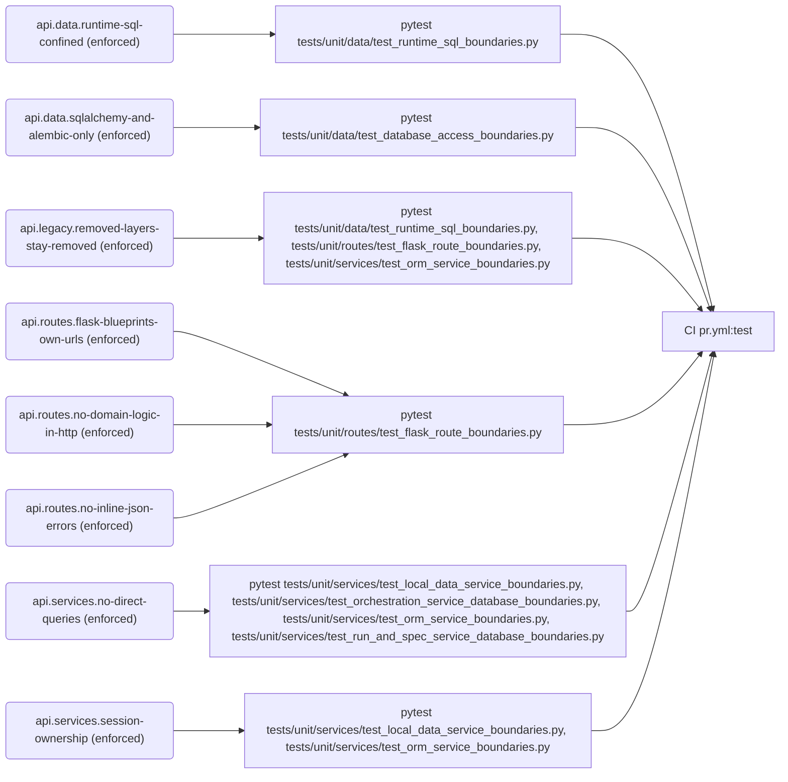

## Import and startup side effects

| Rule | Statement | Tier | Status | Blocking | Enforced by | CI | Proof |
| --- | --- | --- | --- | --- | --- | --- | --- |
| `api.catalog.initializer-not-at-startup` | Application startup modules never import the metadata catalog initializer. | mechanical | enforced | yes | pytest `tests/unit/v2/test_catalog_initialization.py` | `pr.yml:test` | **unproven** |
| `api.startup.fail-closed-configuration` | Default Cloud SQL startup needs no Supabase configuration, and a selected v2 runtime without its database URL fails closed. | mechanical | enforced | yes | pytest `tests/unit/v2/test_import_side_effects.py` | `pr.yml:test` | **unproven** |
| `api.startup.no-import-side-effects` | Importing v2 modules opens no network connections, starting up and serving a request open none unless the process runs on Cloud Run or has a v2 runtime database configured, and none of them creates files or runtime SQLite databases. | mechanical | enforced | yes | pytest `tests/unit/v2/test_import_side_effects.py` | `pr.yml:test` | **unproven** |
| `api.startup.no-runtime-sqlite-modules` | Runtime SQLite modules are absent from the production package. | mechanical | enforced | yes | pytest `tests/unit/v2/test_import_side_effects.py` | `pr.yml:test` | **unproven** |

```mermaid
flowchart LR
  r_api_catalog_initializer_not_at_startup("api.catalog.initializer-not-at-startup (enforced)")
  e_pytest_tests_unit_v2_test_catalog_initialization_py["pytest tests/unit/v2/test_catalog_initialization.py"]
  j_CI_pr_yml_test["CI pr.yml:test"]
  r_api_startup_fail_closed_configuration("api.startup.fail-closed-configuration (enforced)")
  e_pytest_tests_unit_v2_test_import_side_effects_py["pytest tests/unit/v2/test_import_side_effects.py"]
  r_api_startup_no_import_side_effects("api.startup.no-import-side-effects (enforced)")
  r_api_startup_no_runtime_sqlite_modules("api.startup.no-runtime-sqlite-modules (enforced)")
  r_api_catalog_initializer_not_at_startup --> e_pytest_tests_unit_v2_test_catalog_initialization_py
  e_pytest_tests_unit_v2_test_catalog_initialization_py --> j_CI_pr_yml_test
  r_api_startup_fail_closed_configuration --> e_pytest_tests_unit_v2_test_import_side_effects_py
  e_pytest_tests_unit_v2_test_import_side_effects_py --> j_CI_pr_yml_test
  r_api_startup_no_import_side_effects --> e_pytest_tests_unit_v2_test_import_side_effects_py
  r_api_startup_no_runtime_sqlite_modules --> e_pytest_tests_unit_v2_test_import_side_effects_py
```

## Data source isolation

| Rule | Statement | Tier | Status | Blocking | Enforced by | CI | Proof |
| --- | --- | --- | --- | --- | --- | --- | --- |
| `api.catalog.extractor-import-isolation` | The catalog extractor never imports PolicyEngine core, country packages or v1 metadata directly. | mechanical | enforced | yes | pytest `tests/unit/v2/test_catalog_extraction.py` | `pr.yml:test` | **unproven** |
| `api.catalog.selection-validation-no-database` | Importing catalog_selection_validation (catalog version validation, its error types and SelectedCatalog) loads no SQLAlchemy, SQLModel, v2 table model or v2 database module; the catalog query lives in catalog_selection_reads. | mechanical | enforced | yes | pytest `tests/unit/v2/test_catalog_selection_modules.py` | `pr.yml:test` | yes |
| `api.metadata.read-modules-isolated` | v2 metadata read modules never import PolicyEngine packages or v1 metadata sources. | mechanical | enforced | yes | pytest `tests/unit/v2/test_metadata_service.py` | `pr.yml:test` | **unproven** |
| `api.reports.v1-persistence-only` | The existing report route and service import only v1 persistence. | mechanical | enforced | yes | pytest `tests/unit/v2/test_report_v1_runtime_selection.py` | `pr.yml:test` | **unproven** |
| `api.stage12.comparison-tables-isolated` | Serving routes and services never read the Stage 12 comparison tables, and production tables never depend on them. | mechanical | enforced | yes | pytest `tests/unit/v2/test_stage12_comparison_isolation.py` | `pr.yml:test` | **unproven** |
| `api.stage12.retirement-owned` | Retiring the Stage 12 comparison schema stays owned by a named follow-up change in the Stage 12 worker contract. | mechanical | enforced | yes | pytest `tests/unit/v2/test_stage12_comparison_isolation.py` | `pr.yml:test` | **unproven** |
| `api.v2.single-orm-layer` | v2 models never create a parallel SQLAlchemy ORM layer alongside SQLModel. | mechanical | enforced | yes | pytest `tests/unit/v2/test_model_persistence.py` | `pr.yml:test` | **unproven** |

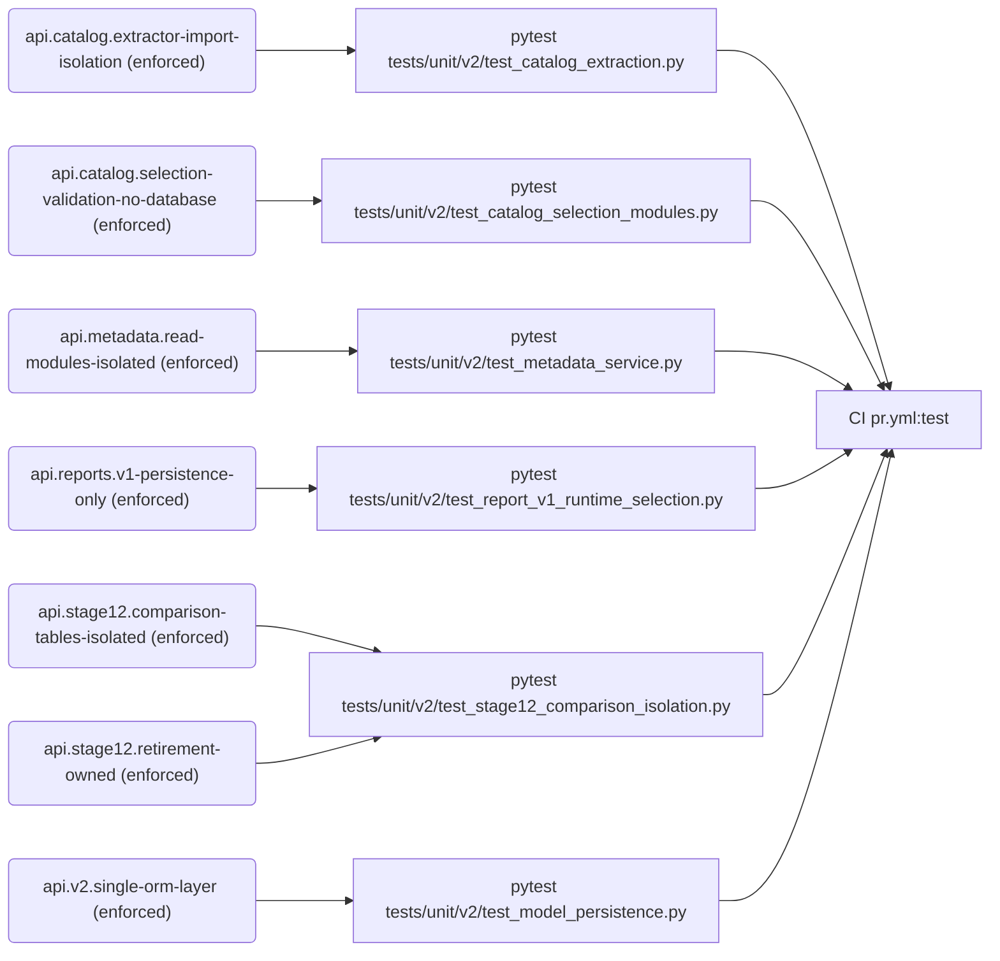

## Migration and schema

| Rule | Statement | Tier | Status | Blocking | Enforced by | CI | Proof |
| --- | --- | --- | --- | --- | --- | --- | --- |
| `api.migration.alembic-autogenerated-only` | Alembic revisions are autogenerated against an explicitly selected v1 or v2 configuration; never hand-written DDL or data operations. | mechanical | doc-only | no | nothing | — | — |
| `api.migration.alembic-v1-qualified` | v1 Alembic revisions qualify against a disposable MySQL database. | mechanical | enforced | yes | CI job `alembic-v1-check` | `pr.yml:alembic-v1-check` | — |
| `api.migration.alembic-v2-qualified` | v2 Alembic revisions qualify against a disposable Postgres database, and alembic check finds no schema drift. | mechanical | enforced | yes | CI job `alembic-v2-check` | `pr.yml:alembic-v2-check` | — |
| `api.migration.bundle-supported-by-simulation-api` | The installed PolicyEngine bundle is the latest one the simulation API has published, checked on every pull request and before each staging and production deploy. | mechanical | enforced | yes | CI job `ensure-policyengine-bundle-supported-by-simulation-api` | `pr.yml:ensure-policyengine-bundle-supported-by-simulation-api` | — |
| `api.migration.contracts-consistent` | Migration route groups and workflow contracts are internally consistent, and their generated docs are current. | mechanical | enforced | yes | quality guard `migration-contracts` | `pr.yml:quality-guards` | **unproven** |
| `api.migration.cross-database-integration` | Cross-database integration tests pass against real MySQL and Postgres. | mechanical | enforced | yes | CI job `v2-integration-check` | `pr.yml:v2-integration-check` | — |
| `api.v2.deployed-privileges-match` | Every v2 deploy grants the managed roles each privilege policyengine_api/data/v2/privileges.py declares, on the whole table or on the columns it names, right after the schema upgrade, reports privileges it doesn't declare without revoking them, and stops before the catalog is seeded if a declared privilege is still missing or a role holds on a whole table a privilege declared for only some of its columns. A declared role listed in ROLES_AWAITING_PROVISIONING that doesn't exist yet is named in the job summary and skipped instead. | mechanical | enforced | yes | CI job `seed`, `catalog-runtime-integration` | `seed-v2-database.yml:seed`, `v2-integration-check.yml:catalog-runtime-integration` | yes |
| `api.v2.runtime-privileges-declared` | Every v2 table has an entry for each managed database role in policyengine_api/data/v2/privileges.py; a privilege declared on only some of a table's columns names columns of that table and is never also declared on the whole table; and every privilege a v2 connector module needs (from its reads, creates, updates or deletes module name and its row locks) is declared for the role that runs it, on the whole table. | mechanical | enforced | yes | pytest `tests/unit/v2/test_privilege_manifest.py` | `pr.yml:test` | yes |
| `api.v2.runtime-privileges-tested-as-runtime-role` | The cross-database integration tests run the v2 user services and the parameter tree read as policyengine_v2_runtime, catalog publication as policyengine_v2_catalog_writer, the comparison-run services as policyengine_stage12_<environment>, and the simulation API's table writes as policyengine_v2_simulation_service and policyengine_v2_modal_worker, holding only their declared privileges, so a statement those privileges don't allow fails CI. | mechanical | enforced | yes | CI job `v2-integration-check`, `catalog-runtime-integration` | `pr.yml:v2-integration-check`, `v2-integration-check.yml:catalog-runtime-integration` | — |

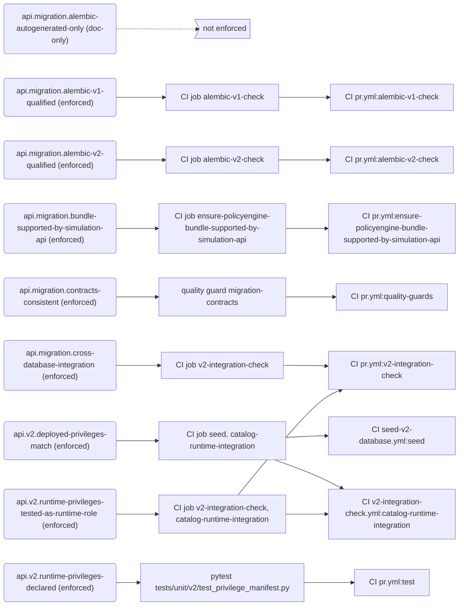

## Weighted microdata

| Rule | Statement | Tier | Status | Blocking | Enforced by | CI | Proof |
| --- | --- | --- | --- | --- | --- | --- | --- |
| `api.microdata.unweighted-series-are-labels` | A MicroSeries built without weights= is a label: it only groups or filters weighted series and is never reduced itself. | mechanical | enforced | yes | pytest `tests/unit/services/test_microdata_weight_boundaries.py` | `pr.yml:test` | yes |
| `api.microdata.weight-stripping-confined` | Raw values are read from weighted microdata (np.array, np.asarray, .values, .to_numpy(), .tolist(), pd.DataFrame or pd.Series) only in a designated stripping module, and the Public API has none yet. | mechanical | enforced | yes | pytest `tests/unit/services/test_microdata_weight_boundaries.py` | `pr.yml:test` | yes |
| `api.microdata.weights-not-aggregated-as-values` | A weight column is never aggregated as a value: never the value of a weighted MicroSeries, the variable of a weighted aggregator, or frame[<weight>] followed by a weighted reduction. | mechanical | enforced | yes | pytest `tests/unit/services/test_microdata_weight_boundaries.py` | `pr.yml:test` | yes |
| `api.microdata.weights-not-values` | Microdata columns are weights, values, labels or counts: weights are only summed plainly to count entities or passed as weights=, values are aggregated with their own entity's weights, labels only group or filter, and counts derive from weights. | mechanical | doc-only | no | nothing | — | — |

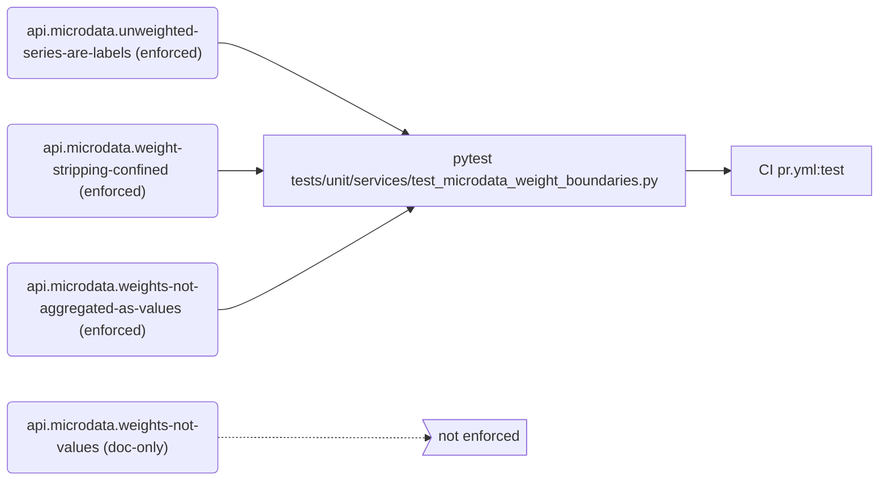

## Code quality and types

| Rule | Statement | Tier | Status | Blocking | Enforced by | CI | Proof |
| --- | --- | --- | --- | --- | --- | --- | --- |
| `api.quality.alembic-revisions-unused-imports` | Ruff neither lints nor formats Alembic revision files (extend-exclude in pyproject.toml), because they must stay exactly as Alembic generates them. | mechanical | advisory | no | nothing | — | — |
| `api.quality.ci-cd-scripts-ruff-exemptions` | CI/CD scripts under .github may print their results, run other programs, fetch fixed URLs, have hyphenated file names and import the lazily loaded packages at module level (T201, S603, S607, S310, N999, TID253); every other ruff rule applies to them. | mechanical | enforced | yes | ruff per-file ignore of N999, S310, S603, S607, T201, TID253 for `.github/**` | `pr.yml:quality-guards` | — |
| `api.quality.command-line-modules-ruff-exemptions` | Application modules that also run as command-line programs (if __name__ == "__main__") may print their output (T201); every other ruff rule applies to them. | mechanical | enforced | yes | ruff per-file ignore of T201 for `policyengine_api/{data/v2/catalog/initialization,data/v2/household_migration_qualification,data/v2/policy_migration_qualification,data/v2/privilege_reconciliation,data/v2/user_association_migration_qualification,worker_spm_release}.py` | `pr.yml:quality-guards` | — |
| `api.quality.command-line-scripts-ruff-exemptions` | Command-line scripts under scripts/ may print their output, run other programs, fetch fixed URLs, stamp today's date and pick random samples (T201, S603, S607, S310, DTZ011, S311); every other ruff rule applies to them. | mechanical | enforced | yes | ruff per-file ignore of DTZ011, S310, S311, S603, S607, T201 for `scripts/**` | `pr.yml:quality-guards` | — |
| `api.quality.coverage-measured` | Codecov measures the same tests on master as on pull requests: every CI job that measures test coverage sends it to Codecov with a flag that codecov.yml carries forward (unit for make test, in pr.yml and in push.yml's release tests; integration for the cross-database integration tests), passing the CODECOV_TOKEN secret, from a job with a timeout of at most 15 minutes; every shard of a report is uploaded, and in a master run an upload fails the run when it fails and no other job waits for it. | mechanical | enforced | yes | pytest `tests/unit/test_codecov_coverage.py` | `pr.yml:test` | yes |
| `api.quality.diff-coverage` | The lines a pull request changes in policyengine_api that coverage.py measures (the first line of each statement) are at least 80% covered by the unit and integration tests together: pr.yml's diff-coverage job runs diff-cover --fail-under=80 on every test shard's and the integration tests' coverage reports, against the commit that the merge commit CI checks out is built on (HEAD^1: the base branch, or a lower stacked pull request's merge commit), and CI complete needs it. | metric | enforced | yes | CI job `diff-coverage` | `pr.yml:diff-coverage` | yes |
| `api.quality.environment-variables-load` | Required environment variables and credentials load in a deployed-like environment. | mechanical | enforced | yes | CI job `test_env_vars` | `pr.yml:test_env_vars` | — |
| `api.quality.file-length` | A tracked Python file has at most 800 physical lines, or at most 1,500 if it is test code (a file under a tests or fixtures directory, or a conftest.py); a longer file is split by responsibility into modules, and keeps its public import path. | metric | enforced | yes | quality guard `file-length` | `pr.yml:quality-guards` | yes |
| `api.quality.make-quality` | make quality is the command for the quality checks, locally and in CI: it applies ruff check --fix and ruff format, then runs make quality-check, which runs uv lock --check, ruff check, ruff format --check, Import Linter, mypy and the quality guards without changing files. Run with a stand-in uv, make quality runs each of them and fails whenever one fails, and make -n prints the same commands. pr.yml's quality-guards job runs make quality and then git diff --exit-code HEAD, with neither step skipped, allowed to fail, or run in another shell or directory, no MAKEFLAGS, GNUMAKEFLAGS or MAKEFILES set for them, and no earlier step writing to GITHUB_ENV or GITHUB_PATH; the Makefile uses no syntax the rules registry doesn't follow and nothing that hides a failing command; and no other pr.yml job's commands run ruff, mypy, lint-imports or the quality guards, directly or through a make target. | mechanical | enforced | yes | pytest `tests/unit/test_make_quality.py` | `pr.yml:test` | yes |
| `api.quality.mypy-v2` | Shared query models, FastAPI dependencies, v2 routes and services, the gzip negotiation, the user sign-in and account-deletion libraries, the country list and its startup check pass mypy with untyped definitions disallowed. | mechanical | enforced | yes | mypy | `pr.yml:quality-guards` | — |
| `api.quality.pre-commit-hook` | make install turns on the git hooks in .githooks through core.hooksPath, a setting of the clone that every worktree shares and resolves against its own checkout, unless that would change an enclosing repository, replace another core.hooksPath, or stop the clone's own hooks (files or symbolic links), which .githooks/turn-on.sh says, always exiting 0. pre-commit runs make quality from the root of the working tree before git commit, and pre-merge-commit runs it before a merge commits without conflicts, with make's variables from the environment cleared. Because make quality checks the working tree, the hook stops the commit, naming the files or what to install, when the working tree holds unstaged changes to tracked files (case-only renames included), skip-worktree or assume-unchanged files, untracked files outside the ignore files, Python files or tool settings that only local or global excludes hide (outside virtual environments), or tracked Python files those excludes match; when make quality fails; when ruff's fixes changed a file; or when make, uv or the dev environment is missing. | mechanical | enforced | yes | pytest `tests/unit/test_pre_commit_hook.py` | `pr.yml:test` | yes |
| `api.quality.ruff-format` | All Python files are formatted with ruff format. | mechanical | enforced | yes | ruff format | `pr.yml:quality-guards` | — |
| `api.quality.ruff-lint` | All Python code passes ruff check with every ruff rule selected (ALL), with no ratchet, except the ignores in pyproject.toml: COM812 and ISC001, which conflict with ruff format, and D203 and D213, which conflict with the kept D211 and D212. | mechanical | enforced | yes | ruff check (ALL) | `pr.yml:quality-guards` | — |
| `api.quality.runtime-evaluated-models-resolve` | Every package model is one ruff treats as runtime-evaluated (a base resolves, through the import in its own module, to a name in runtime-evaluated-base-classes, or is a same-module class that does), and every Pydantic model and SQLAlchemy mapper resolves its annotations once the package is imported. | mechanical | enforced | yes | pytest `tests/unit/test_runtime_evaluated_annotations.py` | `pr.yml:test` | **unproven** |
| `api.quality.suppressions-explained` | Every noqa, ruff: disable and type: ignore comment names what it suppresses and says why: a noqa comment, line-level or file-level (ruff: noqa, flake8: noqa), lists its ruff codes, a ruff: disable range suppression lists its ruff codes in brackets, a type: ignore comment lists its mypy error codes in brackets, and the comment also gives a reason in another # part, as # noqa: CODE  # reason or # type: ignore[code]  # reason; apart from the suppressions rules/baselines/suppressions.txt lists. | mechanical | ratcheted | yes | quality guard `suppressions` | `pr.yml:quality-guards`, `push.yml:quality-guards` | yes |
| `api.quality.tests-assert` | Every test function pytest or unittest collects checks something: its body contains an assert, a raise AssertionError, pytest.raises, pytest.warns, pytest.deprecated_call or pytest.fail, a call to an assert function or method (unittest's self.assertEqual, a mock's assert_called_once_with) or self.fail, or a call to a test helper that does (a function of the same file, a method of the test's class, or a function imported by name from test code); apart from the tests rules/baselines/tests-without-checks.txt lists. | mechanical | ratcheted | yes | quality guard `asserting-tests` | `pr.yml:quality-guards`, `push.yml:quality-guards` | yes |
| `api.quality.tests-pass` | The unit, contract and to-refactor test suites pass, each test in exactly one of the shards they run in. | mechanical | enforced | yes | CI job `test`, `check-test-shards` | `pr.yml:test`, `pr.yml:check-test-shards` | — |
| `api.quality.tests-ruff-exemptions` | Test files may use pytest's bare assert, need no docstrings, annotations or named constants for magic numbers, and may reach into private members, live outside packages and import inside a test (S101, D1, ANN, PLR2004, SLF001, INP001, PLC0415). Their fakes may name methods after the interface they replace, such as a gRPC stub's Export (N802). They may also use fake credentials, naive datetimes, subprocess calls to repository scripts, SQL built from strings and prints (S105, S106, DTZ001, DTZ011, S603, S607, S608, T201), may import the lazily loaded packages at module level (TID253), and may leave a stand-in's arguments unused (ARG001, ARG002, ARG005). Every other ruff rule applies to tests. | mechanical | enforced | yes | ruff per-file ignore of ANN, ARG001, ARG002, ARG005, D1, DTZ001, DTZ011, INP001, N802, PLC0415, PLR2004, S101, S105, S106, S603, S607, S608, SLF001, T201, TID253 for `**/tests/**` | `pr.yml:quality-guards` | — |
| `api.quality.unittest-ruff-exemptions` | The shared rules tool's tests use unittest, because the tool needs only the standard library, so ruff's pytest-style rules (PT) don't apply to them. | mechanical | enforced | yes | ruff per-file ignore of PT for `scripts/rules/tests/**` | `pr.yml:quality-guards` | — |

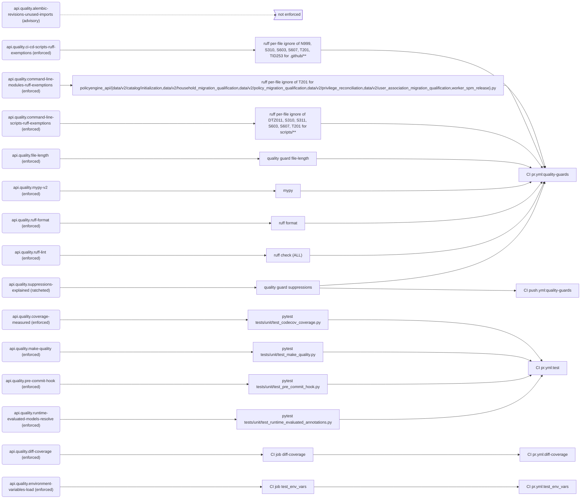

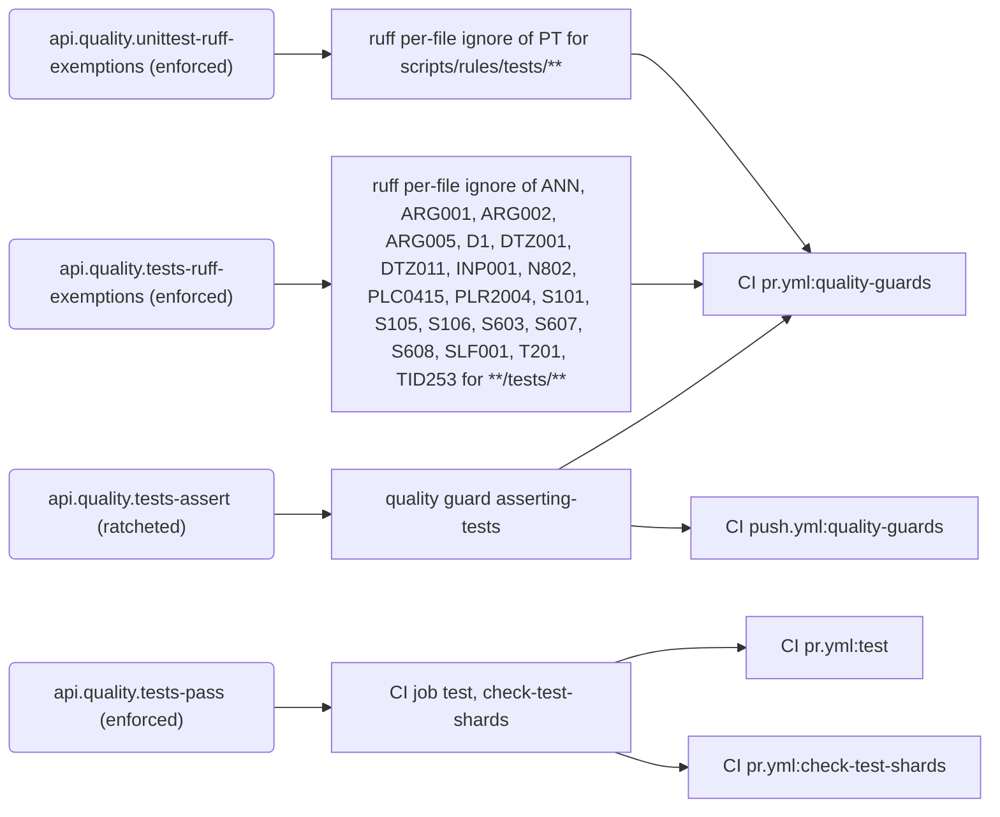

## Observability

| Rule | Statement | Tier | Status | Blocking | Enforced by | CI | Proof |
| --- | --- | --- | --- | --- | --- | --- | --- |
| `api.observability.id-is-diagnostic-only` | observability_id is used only to query diagnostic records, never for idempotency, cache ownership, authorization, database identity, routing or calculation behavior. | mechanical | doc-only | no | nothing | — | — |
| `api.observability.registered-stages-only` | Span names come from the stage plans in policyengine_api.observability.stages; route and service code never adds span-name string literals. | mechanical | doc-only | no | nothing | — | — |

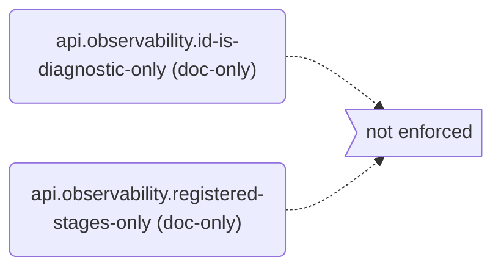

## CI workflows and scripts

| Rule | Statement | Tier | Status | Blocking | Enforced by | CI | Proof |
| --- | --- | --- | --- | --- | --- | --- | --- |
| `api.ci.multiline-run-is-script` | A GitHub Actions run: block holds one line of code and no chained commands (&&, \|\|, ;); anything more lives in a tested script under .github/scripts/, called from a single-line step. | mechanical | enforced | yes | quality guard `ci-scripts` | `pr.yml:quality-guards` | yes |
| `api.ci.shell-scripts-pass-shellcheck` | Every shell script under .github/scripts/ passes shellcheck. | mechanical | enforced | yes | quality guard `ci-scripts` | `pr.yml:quality-guards` | yes |
| `api.ci.workflow-scripts-tested` | Every shell script a workflow calls is run by at least one test. | mechanical | enforced | yes | quality guard `ci-scripts` | `pr.yml:quality-guards` | yes |

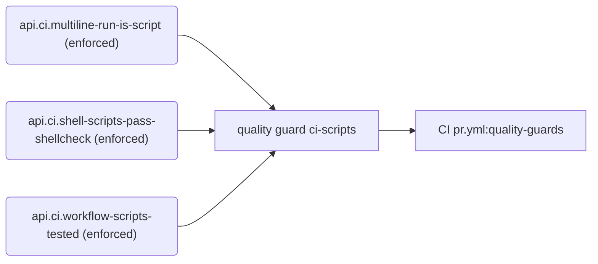

## Dependencies and uv.lock

| Rule | Statement | Tier | Status | Blocking | Enforced by | CI | Proof |
| --- | --- | --- | --- | --- | --- | --- | --- |
| `api.dependencies.declared-and-used` | pyproject.toml declares what policyengine_api imports and nothing else: deptry finds no import that no declared distribution provides (DEP001), no declared runtime dependency the package never imports (DEP002), no import of a module installed only as another package's dependency (DEP003), no import of a package declared only as a development dependency (DEP004) and no declared standard-library module (DEP005), apart from the findings rules/baselines/deptry.txt lists and the rule's not-imported-package exceptions. | mechanical | ratcheted | yes | quality guard `declared-dependencies` | `pr.yml:quality-guards`, `push.yml:quality-guards` | yes |
| `api.dependencies.install-from-lock` | Every install of Python packages in a workflow, a shell script, a Makefile, a Dockerfile or a Modal image installs exactly what uv.lock pins (uv sync --frozen, uv run --frozen), unless it is a registered exception. | mechanical | enforced | yes | quality guard `locked-installs` | `pr.yml:quality-guards` | yes |
| `api.dependencies.lock-committed` | Every directory with a pyproject.toml has a committed uv.lock beside it, and a pull request CI job runs uv lock --check for it. | mechanical | enforced | yes | quality guard `locked-installs` | `pr.yml:quality-guards`, `pr.yml:quality-guards` | yes |
| `api.dependencies.scheduled-relock` | A workflow on a schedule relocks every uv.lock with upgrades and opens or updates a pull request with the result. | mechanical | enforced | yes | quality guard `locked-installs` | `pr.yml:quality-guards` | yes |
| `api.dependencies.test-from-lock` | Every test command in a workflow, a shell script, a Makefile or a Dockerfile runs inside the uv.lock environment, through uv run --frozen. | mechanical | enforced | yes | quality guard `locked-installs` | `pr.yml:quality-guards` | yes |

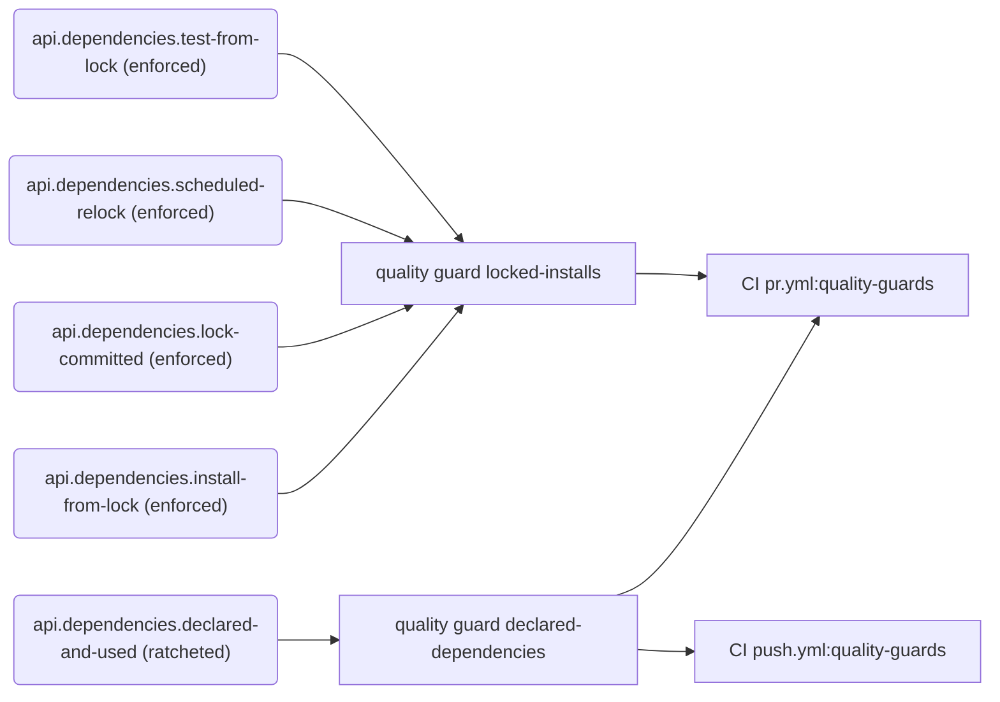

## Process and repository hygiene

| Rule | Statement | Tier | Status | Blocking | Enforced by | CI | Proof |
| --- | --- | --- | --- | --- | --- | --- | --- |
| `api.agents.adapters-point-to-agents-md` | CLAUDE.md and .github/copilot-instructions.md only point to AGENTS.md; skills and rules are listed in AGENTS.md alone. | mechanical | enforced | yes | quality guard `rules-registry` | `pr.yml:quality-guards` | yes |
| `api.process.agents-never-bypass` | Agents never bypass branch rules, even with admin credentials: no gh pr merge --admin and no bypass option; a blocked merge is reported to a human. | mechanical | doc-only | no | nothing | — | — |
| `api.process.agents-suppress-as-last-resort` | Agents add an inline suppression (noqa or type: ignore) only when neither a code change nor a checker setting removes the finding, and a PR lists every inline suppression it adds, with the reason. That each suppression names its code and gives its reason is the mechanical rule api.quality.suppressions-explained. | judgment | doc-only | no | nothing | — | — |
| `api.process.changelog-fragment` | Every PR adds, relative to its base commit, at least one changelog fragment of its own, a non-empty file directly in changelog.d/ named `<name>.<type>.md` with a type from [tool.towncrier] in pyproject.toml, and leaves nothing else there but .gitkeep; the PR check and the release's version bump read fragments through one definition, .github/changelog_fragments.py. | mechanical | enforced | yes | CI job `check-changelog`, `versioning` | `pr.yml:check-changelog`, `push.yml:versioning` | yes |
| `api.process.cloud-run-image-builds` | The Cloud Run container image builds. | mechanical | enforced | yes | CI job `test_cloud_run_container_builds` | `pr.yml:test_cloud_run_container_builds` | — |
| `api.process.docker-image-builds` | The API Docker image builds. | mechanical | enforced | yes | CI job `test_container_builds` | `pr.yml:test_container_builds` | — |
| `api.process.makefile-phony` | Command-only Makefile targets are declared in .PHONY, and .PHONY stays in sync when targets are renamed or removed. | mechanical | doc-only | no | nothing | — | — |
| `api.process.pr-tracking-issue` | The first line of every PR's description is Fixes #ISSUE_NUMBER, naming an open issue, not a pull request, in this repository; automated PRs open or reuse such an issue. | mechanical | enforced | yes | CI job `pr-description` | `pr-description.yml:pr-description` | yes |
| `api.process.rule-machinery-code-owned` | Changes to the rule machinery (rules/, scripts/rules/, scripts/guards/, scripts/run_quality_guards.py and CODEOWNERS) need approval from a core developer other than the author. | mechanical | doc-only | no | nothing | — | — |
| `api.process.rules-registry` | Every rule is registered in rules/registry.toml, is enforced where it claims to be, and its rendered views are current. | mechanical | enforced | yes | quality guard `rules-registry` | `pr.yml:quality-guards` | **unproven** |
| `api.process.stacked-prs-full-ci-at-bottom` | In a stack of pull requests, only the lowest unmerged one runs the full PR workflow. Every pr.yml job is needed by the CI complete gate, which fails on the pull requests above it and otherwise passes only when every job passed, so a stack merges bottom-up and nothing merges untested. | mechanical | enforced | yes | pytest `tests/unit/test_ci_complete_gate.py` | `pr.yml:test`, `pr.yml:ci-complete` | yes |

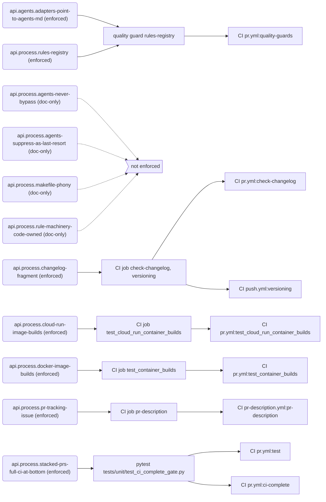
